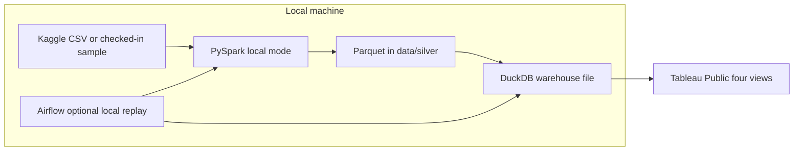

# Clickstream to Cohorts

E-commerce clickstream, turned into the datasets a growth team actually uses: funnel health, cart abandonment, weekly cohort retention, 7 day activation, revenue drivers, and experiment sample sizes.

The source is the public [REES46 e-commerce behavior dataset](https://www.kaggle.com/datasets/mkechinov/ecommerce-behavior-data-from-multi-category-store) on Kaggle (October and November 2019). Raw files are large CSV extracts. This repo types them, drops exact duplicates, writes date partitioned Parquet on the laptop, and models sessions, orders, and product marts in a local DuckDB file. Tableau Public is the reading surface. Rutvij Kulkarni publishes that workbook. The URL below stays a placeholder until that happens.

## Problem

A multi category store logs `view`, `cart`, `remove_from_cart`, and `purchase` events. Product, growth, and experimentation work all need the same facts, and they need them to agree:

- Where sessions drop between view, cart, and purchase, including sessions that cart or purchase without the earlier step.
- Which category and price band combinations abandon the cart.
- Whether a weekly cohort comes back, and whether new users purchase within 7 days.
- How sessions, conversion rate, and average order value move revenue from one observed day to the next.
- How large a two arm test must be before a 2 percent or 5 percent relative lift is detectable.

The warehouse answers those questions from one star schema. Metrics are defined once in dbt and tested on every build.

## Architecture



The same diagram is in [docs/architecture.mmd](docs/architecture.mmd) and [docs/architecture.png](docs/architecture.png).

PySpark runs in local mode, one month at a time, and writes Parquet under `data/silver/events`, partitioned by `event_date`. A rerun overwrites only the dates in that file. dbt, through the DuckDB adapter, builds staging, intermediate, a core star schema, and the marts into `dbt/target/clickstream.duckdb`. `make export` writes the eight marts to `data/exports` as CSV for Tableau Public.

Airflow is optional. It replays 2019-10-01 through 2019-11-30 one day at a time after the Parquet is on disk. The last logical date is 2019-11-30 because the DAG end is exclusive at 2019-12-01. That is 61 days, with catchup on and one active run.

## Stack

| Piece | Choice |
| --- | --- |
| Ingest | PySpark 3.5, local mode |
| Lake | Parquet on local disk, partitioned by `event_date` |
| Warehouse | DuckDB file, dbt 1.11 with `dbt-duckdb` |
| Orchestration | Optional. Astro Runtime 12.12.0, or `airflow standalone` if Airflow is already installed |
| CI | GitHub Actions: ruff, pytest, sqlfluff, `dbt parse`, DuckDB `dbt build` |
| Docs | `dbt docs generate --empty-catalog --static`, GitHub Pages |
| BI | Tableau Public, four views, published separately |

Nothing in this pipeline calls a cloud warehouse. CI uses the checked-in synthetic fixture and never downloads Kaggle.

## Data model

`user_session` from the source file is the session key in every mart. A separate Spark job compares that key with a 30 minute inactivity rule and writes a disagreement report. It does not replace the logged session. A gap of exactly 30 minutes stays in the same derived session. A longer gap starts a new one. The rate is disagreeing consecutive pairs divided by all consecutive pairs for the same user. A pair disagrees when it shares a `user_session` and the gap is over 30 minutes, or the gap is 30 minutes or less and `user_session` changes.

Revenue is the sum of purchase prices. There is no quantity field. One order is one purchasing session. Conversion rate is purchasing sessions divided by sessions. Average order value is revenue divided by purchasing sessions, and 0 when a day has sessions but no purchase. The identity `sessions * cvr * aov = revenue` is a dbt test.

Null `category_code` and `brand` become `Unknown` after staging. `category_l1` is never null. Price bands are `under_10`, `10_to_50`, `50_to_200`, `200_to_500`, and `500_plus`.

| Layer | Models |
| --- | --- |
| Input | `data/silver/events` Parquet, or the `events_silver` seed in CI |
| Staging | `stg_rees46__events` |
| Intermediate | `int_events_enriched`, `int_sessions`, `int_orders`, `int_user_first_activity` |
| Core | `dim_date`, `dim_users`, `dim_products`, `dim_categories`, `fct_events`, `fct_sessions`, `fct_orders` |
| Marts | `mart_daily_kpis`, `mart_funnel_daily_by_category`, `mart_cart_abandonment`, `mart_cohort_retention_weekly`, `mart_activation`, `mart_revenue_drivers_daily`, `mart_category_monetization`, `mart_experiment_baselines` |

That is 20 dbt models. Confirm with:

```bash
cd dbt && dbt ls --resource-type model --quiet --profiles-dir .
```

Data tests cover unique keys, accepted event types, relationships, week 0 retention equal to 1, the revenue identity, category shares, order revenue against purchase events, funnel exceptions, and a non empty experiment baseline. Confirm the test count with:

```bash
cd dbt && dbt ls --resource-type test --quiet --profiles-dir .
```

The project currently defines 95 data tests. Definitions live in [dbt/models/docs.md](dbt/models/docs.md).

`fct_events` is incremental. A daily run passes `event_date` and replaces only that date. `make run` does a full refresh of every Parquet partition on disk.

### Metric definitions

| Metric | Definition |
| --- | --- |
| Session CVR | Purchasing sessions / sessions |
| AOV | Revenue / purchasing sessions |
| View to cart | Sessions with a view and a cart / sessions with a view, inside the slice |
| Cart to purchase | Sessions with a cart and a purchase / sessions with a cart |
| Cart abandonment | Cart sessions with no purchase in the same day, category, and price band / cart sessions |
| Weekly retention | Users with any event in that week / users whose first event is in the cohort week. Week 0 is 1 |
| Activation, 7 days | Share of the cohort whose first purchase is at most 168 hours after the first event |
| Experiment sample size | Sessions per arm, two sided two proportion test, alpha 0.05, power 0.8, relative MDE 0.02 and 0.05. Comparison rate is capped below 1. Estimated days assume both arms run in parallel |

## Repository layout

```text
ingestion/download.sh          Kaggle download from KAGGLE_USERNAME and KAGGLE_KEY
spark/jobs/                    CSV to local Parquet, and the session disagreement report
spark/tests/fixtures/          Synthetic raw CSV used by pytest and by make run
scripts/run_local.py           End to end local pipeline
dbt/                           Models, seeds, tests, DuckDB profile
airflow/                       Optional Astro project and the two DAGs
dashboards/                    Field level spec for the four Tableau views
docs/                          Architecture diagram
data/silver                    Local Parquet lake, gitignored
data/exports                   Mart CSV files for Tableau Public, gitignored
```

The synthetic fixture is generated, not a sample of the REES46 files. It exists so pytest, `make ci`, and `make run` work before a Kaggle download. Do not quote fixture row counts as project results.

## How to run

Requirements: Python 3.11 or newer, Java 17 (Temurin or OpenJDK), and GNU make. A Kaggle token is required only for the full October and November files. Tableau Public is a separate publish step. Airflow is optional.

```bash
python -m venv .venv
source .venv/bin/activate
make install
cp .env.example .env
```

Prove the project before downloading anything:

```bash
make ci
make run
```

`make ci` runs ruff, pytest (PySpark on the synthetic CSV), `dbt parse`, a full DuckDB `dbt build` on the seed, the 7 day `dev_mode` build, and sqlfluff.

`make run` is the whole pipeline. With no files in `data/raw`, it ingests the checked-in fixture into `data/silver/events`, writes the session report, builds the DuckDB warehouse from that Parquet, and exports `data/exports/*.csv`. When `data/raw/2019-Oct.csv` or `data/raw/2019-Nov.csv` is present, it ingests those months instead. Spark driver memory for a month is `SPARK_DRIVER_MEMORY` (default `8g`). The sample path uses `1g`.

### Full extract

Create a Kaggle token at https://www.kaggle.com/settings, put `KAGGLE_USERNAME` and `KAGGLE_KEY` in `.env`, and accept the dataset terms on the Kaggle page. Then:

```bash
set -a && source .env && set +a
make download
make run
```

`make download` fetches `2019-Oct.csv` and `2019-Nov.csv` only. `make run` then rebuilds silver Parquet, the DuckDB warehouse, and the Tableau CSV files. `make reconcile` prints Spark `output_rows` next to the Parquet count and exits 1 if they differ.

### Optional day by day replay

Run `make run` first so every ingested day is already in DuckDB. Then either start the Astro project:

```bash
cd airflow
astro dev start
```

or, if Apache Airflow is already installed on the machine:

```bash
export AIRFLOW_HOME=$PWD/.airflow
export CLICKSTREAM_HOME=$PWD
export PYTHONPATH=$PWD
airflow standalone
```

Unpause `build_daily`. It checks that `data/silver/events/event_date={{ ds }}` exists, refreshes that date in DuckDB, runs `dbt test`, and rewrites `data/exports`. Leave `ingest_month` paused. It is manual (`schedule=None`) and takes `month` as `2019-10` or `2019-11`. Trigger it once per month if you want ingest inside Airflow instead of `make run`.

A catchup started on an empty warehouse only contains the days finished so far, and the quality gate can fail until the window is complete. `make run` is the one-shot path.

## Dashboard

Four Tableau Public views. The field list and chart intent are in [dashboards/README.md](dashboards/README.md). Publish them yourself from `data/exports`, then set `tableau_public_url` in [dbt/dbt_project.yml](dbt/dbt_project.yml) to the workbook URL.

| View | Marts |
| --- | --- |
| Funnel health | `mart_daily_kpis`, `mart_funnel_daily_by_category` |
| Retention and activation | `mart_cohort_retention_weekly`, `mart_activation` |
| Revenue drivers | `mart_revenue_drivers_daily`, `mart_category_monetization`, `mart_cart_abandonment` |
| Experiment planner | `mart_experiment_baselines` |

[Tableau Public URL](https://github.com/Rutvij1998/clickstream-to-cohorts/blob/main/dashboards/README.md)

That link is the spec page, not a published workbook.

## dbt docs

GitHub Pages serves a static docs site with an empty catalog, so fixture row counts are not published. After the site is enabled, the URL is:

https://rutvij1998.github.io/clickstream-to-cohorts/

Build locally with `make dbt-docs` and open `dbt/target/index.html`.

## Results

Numbers below are blank on purpose. Fill each `[N]` from a real run of the October and November files. Do not paste fixture counts, and do not estimate.

| Measure | Value | Source |
| --- | --- | --- |
| Input rows, both months | [N] | `input_rows` in `data/logs/2019-Oct.json` and `data/logs/2019-Nov.json` |
| Silver rows | [N] | `output_rows` in those logs, summed, then checked with `make reconcile` |
| Exact duplicates removed | [N] | `duplicate_rows_removed` in those logs |
| Rejected rows | [N] | `rejected_rows` in those logs |
| Session disagreement rate | [N] | `session_disagreement_rate` in `data/logs/session_disagreement.json` |

After both months have been ingested:

```bash
python - <<'PY'
import json
from pathlib import Path

keys = ["input_rows", "output_rows", "duplicate_rows_removed", "rejected_rows"]
totals = dict.fromkeys(keys, 0)
for path in sorted(Path("data/logs").glob("2019-*.json")):
    payload = json.loads(path.read_text())
    print(path.name, {key: payload.get(key) for key in keys})
    for key in keys:
        totals[key] += int(payload[key])
print("totals", totals)
report = json.loads(Path("data/logs/session_disagreement.json").read_text())
print("session_disagreement_rate", report["session_disagreement_rate"])
PY
```

Replace `[N]` in the table with those totals. The disagreement rate is a fraction from the report, not a rounded guess.

A resume line that stays honest until that run:

> Built a local PySpark and DuckDB pipeline over the public REES46 clickstream (October and November 2019), with 20 dbt models and 95 data tests covering funnel, retention, activation, and experiment baselines. Silver row count [N]. Session disagreement rate against a 30 minute rule [N].

## Design choices

- The warehouse is a DuckDB file on the laptop. Spark writes the Parquet it reads.
- CI never downloads Kaggle. It builds the seed. `make run` without month files builds the same fixture from Parquet.
- Airflow stays optional. `make run` is the supported end to end command.
- Marts keep `user_session`. The 30 minute rule is a data quality report.

## Caveats

- The extract has no traffic source and no quantity. Average order value is price per purchasing session.
- Empty category and brand become `Unknown`. Some purchase events have no cart event in the same session. The funnel mart counts those as `purchase_without_cart_sessions` instead of hiding them.
- The file does not include a country. A late November slice, including 2019-11-29, is only a date filter.
- The Kaggle dataset stays under its own terms. See [DATA.md](DATA.md). This repository's code is MIT. The CSV files are not.
- Ingest one month at a time. The driver default is 8g.
- The replay is a static backfill of two months, not a live feed.
- `dev_mode` reads the first 7 days only. The daily DAG does not set `dev_mode`. It passes `event_date` and replaces that date in `fct_events`.

## License

Code in this repository is [MIT](LICENSE). Copyright (c) 2026 Rutvij Kulkarni.
