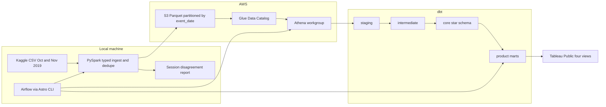

# Clickstream to Cohorts

E-commerce clickstream, turned into the datasets a growth team actually uses: funnel health, cart abandonment, weekly cohort retention, 7 day activation, revenue drivers, and experiment sample sizes.

The source is the public [REES46 e-commerce behavior dataset](https://www.kaggle.com/datasets/mkechinov/ecommerce-behavior-data-from-multi-category-store) on Kaggle (October and November 2019). Raw files are large CSV extracts. This repo types them, drops exact duplicates, writes date partitioned Parquet, and models sessions, orders, and product marts on top. Tableau Public is the reading surface. Rutvij Kulkarni publishes that workbook. The URL below stays a placeholder until that happens.

## Problem

A multi category store logs `view`, `cart`, `remove_from_cart`, and `purchase` events. Product, growth, and experimentation work all need the same facts, and they need them to agree:

- Where sessions drop between view, cart, and purchase, including sessions that cart or purchase without the earlier step.
- Which category and price band combinations abandon the cart.
- Whether a weekly cohort comes back, and whether new users purchase within 7 days.
- How sessions, conversion rate, and average order value move revenue from one observed day to the next.
- How large a two arm test must be before a 2 percent or 5 percent relative lift is detectable.

The warehouse answers those questions from one star schema. Metrics are defined once in dbt and tested on every build.

## Architecture



The same diagram is in [docs/architecture.mmd](docs/architecture.mmd) and [docs/architecture.png](docs/architecture.png).

PySpark runs on the laptop, one month at a time, and writes Parquet partitioned by `event_date`. A rerun overwrites only the dates in that file. Glue and Athena sit on the lake. dbt (the Athena adapter for the warehouse, DuckDB for local development and CI) builds staging, intermediate, a core star schema, and the marts. Airflow, via the Astro CLI, replays 2019-10-01 through 2019-11-30 one day at a time. The last logical date is 2019-11-30 because the DAG end is exclusive at 2019-12-01. That is 61 days, with catchup on and one active run.

## Stack

| Piece | Choice |
| --- | --- |
| Ingest | PySpark 3.5, local mode |
| Lake | S3, SSE-S3, public access blocked, Parquet |
| Catalog and query | Glue Data Catalog, Athena, partition projection on `event_date` |
| Transform | dbt 1.11, `dbt-athena` in the warehouse, `dbt-duckdb` for the dev target and CI |
| Orchestration | Apache Airflow 2 on [Astro Runtime 12.12.0](https://quay.io/repository/astronomer/astro-runtime), LocalExecutor |
| CI | GitHub Actions: ruff, pytest, sqlfluff, `dbt parse`, DuckDB `dbt build` |
| Docs | `dbt docs generate --empty-catalog --static`, GitHub Pages |
| BI | Tableau Public, four views, published separately |

## Data model

`user_session` from the source file is the session key in every mart. A separate Spark job compares that key with a 30 minute inactivity rule and writes a disagreement report. It does not replace the logged session. A gap of exactly 30 minutes stays in the same derived session. A longer gap starts a new one. The rate is disagreeing consecutive pairs divided by all consecutive pairs for the same user. A pair disagrees when it shares a `user_session` and the gap is over 30 minutes, or the gap is 30 minutes or less and `user_session` changes.

Revenue is the sum of purchase prices. There is no quantity field. One order is one purchasing session. Conversion rate is purchasing sessions divided by sessions. Average order value is revenue divided by purchasing sessions, and 0 when a day has sessions but no purchase. The identity `sessions * cvr * aov = revenue` is a dbt test.

Null `category_code` and `brand` become `Unknown` after staging. `category_l1` is never null. Price bands are `under_10`, `10_to_50`, `50_to_200`, `200_to_500`, and `500_plus`.

| Layer | Models |
| --- | --- |
| Source | `rees46.events_silver` |
| Staging | `stg_rees46__events` |
| Intermediate | `int_events_enriched`, `int_sessions`, `int_orders`, `int_user_first_activity` |
| Core | `dim_date`, `dim_users`, `dim_products`, `dim_categories`, `fct_events`, `fct_sessions`, `fct_orders` |
| Marts | `mart_daily_kpis`, `mart_funnel_daily_by_category`, `mart_cart_abandonment`, `mart_cohort_retention_weekly`, `mart_activation`, `mart_revenue_drivers_daily`, `mart_category_monetization`, `mart_experiment_baselines` |

That is 20 dbt models. Confirm with:

```bash
cd dbt && dbt ls --resource-type model --quiet --profiles-dir .
```

Data tests cover unique keys, accepted event types, relationships, week 0 retention equal to 1, the revenue identity, category shares, order revenue against purchase events, funnel exceptions, and a non empty experiment baseline. Confirm the test count with:

```bash
cd dbt && dbt ls --resource-type test --quiet --profiles-dir .
```

The project currently defines 95 data tests. Definitions live in [dbt/models/docs.md](dbt/models/docs.md).

### Metric definitions

| Metric | Definition |
| --- | --- |
| Session CVR | Purchasing sessions / sessions |
| AOV | Revenue / purchasing sessions |
| View to cart | Sessions with a view and a cart / sessions with a view, inside the slice |
| Cart to purchase | Sessions with a cart and a purchase / sessions with a cart |
| Cart abandonment | Cart sessions with no purchase in the same day, category, and price band / cart sessions |
| Weekly retention | Users with any event in that week / users whose first event is in the cohort week. Week 0 is 1 |
| Activation, 7 days | Share of the cohort whose first purchase is at most 168 hours after the first event |
| Experiment sample size | Sessions per arm, two sided two proportion test, alpha 0.05, power 0.8, relative MDE 0.02 and 0.05. Comparison rate is capped below 1. Estimated days assume both arms run in parallel |

## Repository layout

```text
ingestion/download.sh          Kaggle download from KAGGLE_USERNAME and KAGGLE_KEY
spark/jobs/                    CSV to Parquet, and the session disagreement report
spark/tests/fixtures/          Synthetic raw CSV used by pytest
scripts/                       Ingest, upload, export, reconcile, fixture generator
dbt/                           Models, seeds, tests, profiles
airflow/                       Astro project and the two DAGs
infra/                         Terraform, boto3 bootstrap, Athena DDL, IAM policy
dashboards/                    Field level spec for the four Tableau views
docs/                          Architecture diagram
```

The synthetic fixture is generated, not a sample of the REES46 files. It exists so pytest and the DuckDB build run with no AWS account and no Kaggle token. Do not quote fixture row counts as project results.

## How to run

Requirements: Python 3.11 or newer, Java 17 (Temurin or OpenJDK), and GNU make. The full warehouse also needs an AWS account, Terraform 1.6 or newer (or boto3, which the bootstrap script uses), the [Kaggle CLI](https://github.com/Kaggle/kaggle-api) token, and the [Astro CLI](https://www.astronomer.io/docs/astro/cli/install-cli) for Airflow. Tableau Public is a separate publish step.

```bash
python -m venv .venv
source .venv/bin/activate
make install
cp .env.example .env
```

Fill `.env` from the checklist at the bottom. Never commit `.env`.

Prove the local path before any cloud cost:

```bash
make ci
```

That runs ruff, pytest (PySpark on the synthetic CSV), `dbt parse` for the DuckDB and Athena targets, a full DuckDB `dbt build`, and sqlfluff.

### Warehouse, cost controls

Terraform creates a bucket (prefix `clickstream-cohorts-`, `force_destroy` on), blocks public access, encrypts with SSE-S3, expires `athena-results/` after 7 days, creates Glue databases `rees46`, `staging`, `intermediate`, `core`, and `marts`, registers `rees46.events_silver` with partition projection for 2019-10-01 to 2019-11-30, creates the Athena workgroup `clickstream-to-cohorts` with a 10 GiB per query scan cap (`10737418240` bytes), and attaches an IAM policy scoped to that bucket, those databases, and that workgroup. An optional email gets a budget alert at 80 percent of 5 USD.

```bash
cd infra/terraform
cp terraform.tfvars.example terraform.tfvars
# set aws_region and, if you want the alert, budget_alert_email
cd ../..
make infra-apply
terraform -chdir=infra/terraform output
```

Copy `bucket_name`, `athena_results_uri`, and `dbt_data_uri` into `.env`. Then attach the policy to the IAM user that will run the jobs:

```bash
aws iam attach-user-policy \
  --user-name YOUR_IAM_USER \
  --policy-arn "$(terraform -chdir=infra/terraform output -raw iam_policy_arn)"
```

Without Terraform, pick a globally unique bucket name, put it in `S3_BUCKET`, and run `make infra-cli`. The script prints the same values and the `attach-user-policy` command. It does not create access keys.

`make dbt-athena` builds with `dev_mode` (the first 7 days only) so exploration stays inside the scan cap. `make dbt-athena-full` is the 61 day build. Do not combine `--full-refresh` with `event_date`.

Planning estimates, not a measured bill: S3 storage under $0.25 for the Parquet and short lived query results, S3 requests under $0.05, Athena under $0.75 if scans stay inside the 10 GiB cap and the 7 day result lifecycle, Glue catalog $0, local compute $0. The design target is under $2. Set `BUDGET_ALERT_EMAIL` before apply if you want the 5 USD alert.

### Full replay

```bash
set -a && source .env && set +a
make download
make ingest-month MONTH=2019-10
make ingest-month MONTH=2019-11
make sessionize
make upload
make dbt-athena
make dbt-athena-full
python scripts/reconcile_counts.py
EXPORT_TARGET=athena make export
```

`make download` reads `KAGGLE_USERNAME` and `KAGGLE_KEY` from the environment or `.env`. It fetches `2019-Oct.csv` and `2019-Nov.csv` only. Spark driver memory defaults to 8g for a full month (`SPARK_DRIVER_MEMORY`).

Airflow, from a sourced `.env`, with `~/.aws` present if you use a profile:

```bash
mkdir -p ~/.aws
cd airflow
astro dev start
```

Unpause `build_daily`. Leave `ingest_month` paused. It is manual (`schedule=None`) and takes `month` as `2019-10` or `2019-11`. Trigger it once per month if you want ingest inside Airflow instead of `make ingest-month`.

`build_daily` runs `check_partition`, then `dbt build` for that `ds` (Athena only; the dev target rebuilds the fixture), then `dbt test` as the data quality gate, then an UNLOAD of the eight marts. Seeds are not built on Athena.

Set `DBT_TARGET=dev` and `EXPORT_TARGET=local` before `astro dev start` to exercise the fixture inside Airflow with no AWS calls. The warehouse replay uses `DBT_TARGET=athena` and `EXPORT_TARGET=athena`.

## Dashboard

Four Tableau Public views. The field list and chart intent are in [dashboards/README.md](dashboards/README.md). Publish them yourself, then set `tableau_public_url` in [dbt/dbt_project.yml](dbt/dbt_project.yml) to the workbook URL and rebuild the exposure.

| View | Marts |
| --- | --- |
| Funnel health | `mart_daily_kpis`, `mart_funnel_daily_by_category` |
| Retention and activation | `mart_cohort_retention_weekly`, `mart_activation` |
| Revenue drivers | `mart_revenue_drivers_daily`, `mart_category_monetization`, `mart_cart_abandonment` |
| Experiment planner | `mart_experiment_baselines` |

[Tableau Public URL](https://github.com/Rutvij1998/clickstream-to-cohorts/blob/main/dashboards/README.md)

That link is the spec page, not a published workbook.

## dbt docs

GitHub Pages serves a static docs site with an empty catalog, so fixture row counts are not published. After the site is enabled, the URL is:

https://rutvij1998.github.io/clickstream-to-cohorts/

Build locally with `make dbt-docs` and open `dbt/target/index.html`.

## Results

Numbers below are blank on purpose. Fill each `[N]` from a real run. Do not paste fixture counts, and do not estimate.

| Measure | Value | Source |
| --- | --- | --- |
| Input rows, both months | [N] | `input_rows` in `data/logs/2019-Oct.json` and `data/logs/2019-Nov.json` |
| Silver rows | [N] | `output_rows` in those logs, summed, then checked with `make reconcile` |
| Exact duplicates removed | [N] | `duplicate_rows_removed` in those logs |
| Rejected rows | [N] | `rejected_rows` in those logs |
| Session disagreement rate | [N] | `session_disagreement_rate` in `data/logs/session_disagreement.json` |

After both months have been ingested:

```bash
python - <<'PY'
import json
from pathlib import Path

keys = ["input_rows", "output_rows", "duplicate_rows_removed", "rejected_rows"]
totals = dict.fromkeys(keys, 0)
for path in sorted(Path("data/logs").glob("2019-*.json")):
    payload = json.loads(path.read_text())
    print(path.name, {key: payload.get(key) for key in keys})
    for key in keys:
        totals[key] += int(payload[key])
print("totals", totals)
report = json.loads(Path("data/logs/session_disagreement.json").read_text())
print("session_disagreement_rate", report["session_disagreement_rate"])
PY
```

Replace `[N]` in the table with those totals. The disagreement rate is a fraction from the report, not a rounded guess.

A resume line that stays honest until that run:

> Built a local PySpark and Athena pipeline over the public REES46 clickstream (October and November 2019), with 20 dbt models and 95 data tests covering funnel, retention, activation, and experiment baselines. Silver row count [N]. Session disagreement rate against a 30 minute rule [N].

## Design choices

- Athena and Glue, with partition projection, keep the warehouse on the files Spark already wrote.
- PySpark stays on the laptop so the month CSV files never have to land in a paid cluster for a portfolio replay.
- DuckDB is the dbt dev target. CI never calls AWS or Kaggle.
- Airflow runs locally through Astro so the 61 day replay is visible, with catchup, and shuts down when you stop it.
- Marts keep `user_session`. The 30 minute rule is a data quality report.

## Caveats

- The extract has no traffic source and no quantity. Average order value is price per purchasing session.
- Empty category and brand become `Unknown`. Some purchase events have no cart event in the same session. The funnel mart counts those as `purchase_without_cart_sessions` instead of hiding them.
- The file does not include a country. A late November slice, including 2019-11-29, is only a date filter.
- The Kaggle dataset stays under its own terms. See [DATA.md](DATA.md). This repository's code is MIT. The CSV files are not.
- Ingest one month at a time. The driver default is 8g.
- The replay is a static backfill of two months, not a live feed.
- Athena facts use `insert_overwrite` on the partitions touched that day. A dev build with `dev_mode` reads the first 7 days only. The daily DAG does not set `dev_mode`.

## License

Code in this repository is [MIT](LICENSE). Copyright (c) 2026 Rutvij Kulkarni.
